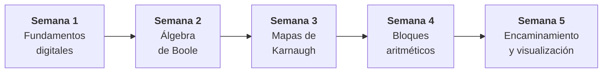

<div align="center">


# UNIVERSIDAD NACIONAL DE LOJA

**Facultad de la Energía, las Industrias y los Recursos Naturales No Renovables**
**Carrera de Computación**

<br>

# 📘 Repositorio de Apuntes
## Diseño de Circuitos

### Unidad 1: Análisis de Lógica Combinacional con Diseño Clásico
*Semanas 1 a 5*


---

## 📋 Ficha académica

| | |
|---|---|
| 👤 **Estudiante** | Abraham Maza |
| 📚 **Asignatura** | Diseño de Circuitos |
| 🎓 **Docente** | Ing. Luis Darío Sinche Cueva |
| 🏫 **Carrera** | Computación |
| 📅 **Ciclo** | Segundo ciclo |
| 🗓️ **Fecha** | 25 de octubre de 2026 |

---

## 📖 Introducción

Este repositorio reúne los **apuntes académicos, ejercicios y fundamentos teóricos** de la **Unidad 1** de *Diseño de Circuitos*. La unidad recorre el hardware digital sobre el que se ejecutan los sistemas informáticos, desde los niveles de voltaje y las compuertas lógicas hasta la construcción de bloques combinacionales con métodos de **diseño clásico**.

Los apuntes son **progresivos**: cada semana asume lo visto en las anteriores y solo explica lo nuevo, por lo que conviene leerlos **en orden**.

---

## 🗺️ Ruta de aprendizaje



---

## 📑 Contenidos

| Semana | Tema | Qué se aprende | Apunte |
|:---:|---|---|:---:|
| **1** | Sistemas numéricos, códigos y compuertas | Niveles lógicos y margen de ruido (74LS) · Binario, octal y hexadecimal · Complemento a dos y *overflow* · Códigos BCD, Gray y ASCII · Las 7 compuertas · Lectura del 74LS08 | [📄 Abrir](semana1.md) |
| **2** | Álgebra de Boole y formas canónicas | Postulados de Huntington y teoremas · Dualidad y De Morgan · Tablas de verdad · Minitérminos y maxitérminos (SOP / POS) · Simplificación algebraica | [📄 Abrir](semana2.md) |
| **3** | Mapas de Karnaugh y compuertas universales | K-Maps de 2, 3 y 4 variables · Agrupación SOP y POS · Condiciones *don't care* · Implementación con NAND y NOR | [📄 Abrir](semana3.md) |
| **4** | Diseño combinacional y bloques aritméticos | Metodología de diseño · Medio sumador y sumador completo · Restadores · Sumador/restador · Comparadores · Práctica APE 04 | [📄 Abrir](semana4.md) |
| **5** | Encaminamiento y visualización de datos | Multiplexores y demultiplexores · Decodificadores y codificadores · *Chip Select* · BCD a 7 segmentos · Integración de bloques | [📄 Abrir](semana5.md) |

---

## 🎯 Al terminar la unidad se podrá

- ⚡ Explicar cómo los voltajes se abstraen en estados lógicos y calcular márgenes de ruido.
- 🔢 Convertir entre sistemas numéricos y operar con enteros con signo en complemento a dos.
- 🧮 Modelar circuitos con álgebra de Boole y expresar funciones en formas canónicas.
- 🗺️ Minimizar funciones con Mapas de Karnaugh y construirlas con compuertas universales.
- ➕ Diseñar sumadores, restadores, sumadores/restadores y comparadores.
- 🔀 Usar multiplexores, decodificadores y codificadores, y manejar displays de 7 segmentos.

---

## 🛠️ Herramientas y componentes

| Herramienta | Uso |
|---|---|
| **Logisim-evolution** | Simulación de los circuitos antes de armarlos |
| **74LS00 · 02 · 04 · 08 · 32 · 86** | Compuertas NAND, NOR, NOT, AND, OR y XOR |
| **74LS83 · 85** | Sumador y comparador de 4 bits |
| **74LS138 · 139 · 148** | Decodificadores y codificador con prioridad |
| **74LS151 · 153 · 157** | Multiplexores |
| **74LS47 · 48** | Decodificadores BCD a 7 segmentos |

---

## 📂 Estructura del repositorio

```text
.
├── README.md      ← Presentación e índice
├── semana1.md     ← Sistemas numéricos, códigos y compuertas lógicas
├── semana2.md     ← Álgebra de Boole y formas canónicas
├── semana3.md     ← Mapas de Karnaugh y compuertas universales
├── semana4.md     ← Diseño combinacional y bloques aritméticos
└── semana5.md     ← Encaminamiento y visualización de datos
```

---

## 🧭 Cómo leer los apuntes

- 🔖 Cada archivo trae **objetivos**, **conocimientos previos**, desarrollo con tablas y diagramas, **resumen** y **autoevaluación** con respuestas desplegables.
- 🧪 Las fórmulas están escritas en **LaTeX** (`$...$`), que GitHub muestra directamente.


---

<div align="center">

**Abraham Maza** · Carrera de Computación · Universidad Nacional de Loja

*Diseño de Circuitos · Segundo ciclo · 2026*

</div>
